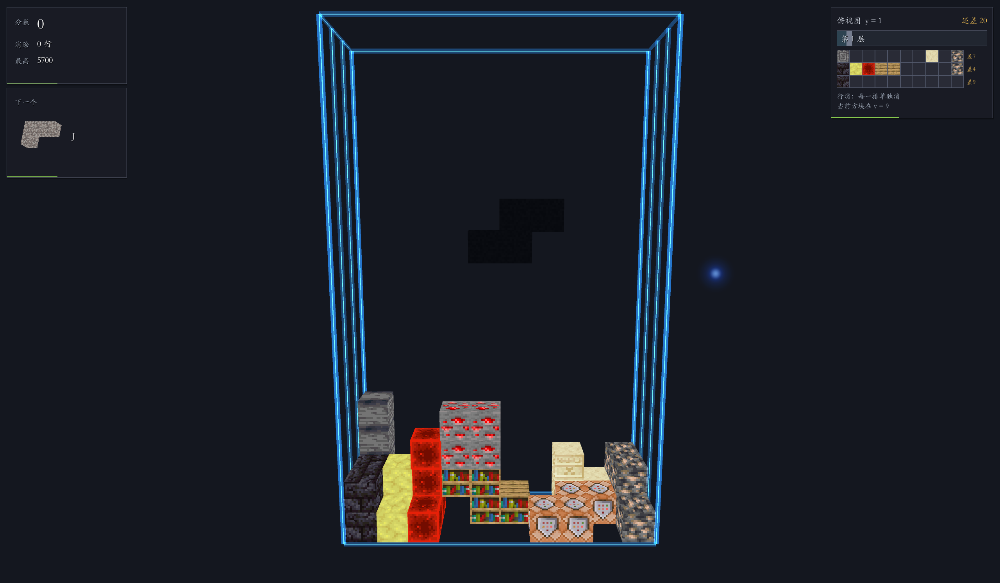

# Minecraft x Tetris 3D

> 我的世界风格的 3D 俄罗斯方块。方块不只是平面的：场地有深度，方块能绕三个轴翻转，
> 水会流、岩浆会烧、沙子会塌。



## 这是什么

2022 年 B 站 UP 主「马克杯MarkCup」做过一个 MC 版俄罗斯方块（TetrisM），已经下不到了。
这个项目是做新的版本：保留 MC 方块外观和方块特性，场地换成真正的 3D 网格。

和原版俄罗斯方块的区别：

- **3D 场地**：x / y / z 三轴可调（默认 10 × 20 × 1），W / S 把方块往深处挪，消除可以在层内也可以按行
- **三轴翻转**：除了常规的面内旋转，还能俯视转 90°（绕竖直轴）和前后翻 90°（绕水平轴），一共 24 种朝向
- **MC 方块特性**：沙子 / 沙砾 / 混凝土粉末会塌落；水和岩浆按「定体积份数」流动，两者相遇生成黑曜石或原石；
  TNT 碰到红石块或岩浆会被点着，引信烧完炸掉半径 2 格内的一切，还会连锁；
  原木落定后会在周围长出一圈树叶（9 种树种）；基岩消除时钉在原地不动；
  结构方块记住整块场地，被消掉时先把场上的方块从下往上一格一格收掉，再把记忆里的方块掉回来
- **原版音效与 BGM**：354 种方块按 MC 的 SoundType 归成 61 组，放下去听到的就是原版那一下；
  背景音乐是 14 首原版常速曲 + 2 首菜单曲，随机播放

## 当前状态

v0.1 可玩版，Windows 已验证。详细进度见 [任务清单](docs/任务清单-v0.1.md)。

已完成：

- 场地 x / y / z 三轴可调（默认 10 × 20 × 1），层消 / 行消两种模式（深度 Z = 1 时固定行消）
- 重力方块、水与岩浆的流动与结晶、流体进存档
- TNT 引爆：红石块 / 岩浆接触点火、白闪引信、球形爆炸、连锁、震屏与碎块
- 原木长树叶：9 种树种，落定后在周围长出一圈叶子（新补了 9 种树叶方块）
- 基岩不随消除下落：消行时钉在原格不动、上面那摞被它托住；自己所在行被消时照样消失
  （常驻方块池，机制可在 设置 → 特殊方块开关 里关掉）
- 结构方块的记忆与还原：落定时记住整块场地的构造，被消行 / 被炸掉时触发还原，
  先让场上的方块从下往上一格一格消失，再把记忆里的方块一格一格掉回来重建；
  演完自己消失；一整块 4 格结构方块只记一条
  （常驻方块池，机制可在 设置 → 特殊方块开关 里关掉）
- 三轴旋转（24 种朝向）、踢墙与重定位、旋转动画
- 61 组放置音效对齐 MC 原版、消除音、界面音；14 + 2 首原版 BGM 随机播放，音量可调
- 命令行式设置界面：场地尺寸、消除模式、下落速度（0.01 ~ 2.00 倍）、音乐音量、十二项特殊方块机制开关、键位自定义、音效开关；
  场地尺寸、下落速度、音乐音量都是 MC 那种拖拽滑条；设置各页字号按 2 倍排（按键 / 机制 / 规则分两列）
- 玻璃被压碎：玻璃落下不会碎，之后有方块压到它上面才碎（上方那块也是玻璃不算压），
  碎完上方的东西接着往下掉，叠几层会一层层塌
- 雪块 / 冰遇岩浆融化：任意一面贴着岩浆就化成一格水，水落进岩浆里再被烫成黑曜石；
  雪块和冰按块数定期发（每 30 块一块），不用在三百多种里碰运气
- 傀儡：南瓜头（雕刻南瓜或普通南瓜）压在雪块 / 铁块 / 铜块上就召出雪 / 铁 / 铜傀儡，
  **用原版实体贴图拼出真模型**（雪傀儡是南瓜头 + 雪球 + 树枝手，铁傀儡带藤蔓和垂过膝的长臂，
  铜傀儡是方头 + 避雷针 + 村民鼻），召出来在场外空地当桌宠自己溜达，铜傀儡会随时间氧化变色，
  南瓜头和脚下那格一起消失，傀儡摆到场地右侧当收藏；机制可在 设置 → 特殊方块开关 里关掉
- 主菜单像素标题、创意工坊（自己画模具）、游戏规则页（玩法 / 按键 / 特殊方块三栏）、十二项特殊方块机制开关、轨道相机、光标荧光拖尾、逻辑自检 267 项

还欠着：立体方块形状（z ≥ 2 的解锁）、WebGL / Android 构建。

## 操作（PC）

| 按键 | 作用 |
|---|---|
| A / D 或 ← / → | 左右移动 |
| W / S 或 ↑ / ↓ | 前后移动（z 轴，场地有深度时才用得上） |
| 空格 | 硬降 |
| Shift | 软降 |
| Q / E | 面内旋转（逆 / 顺时针，绕屏幕法线） |
| Z / C | 俯视旋转（逆 / 顺时针，绕竖直轴） |
| V / R | 前后翻（往正面 / 往背面，绕水平轴） |
| 鼠标拖拽 / 滚轮 | 转视角 / 缩放 |
| Esc | 暂停 |

键位都能在设置里改，改完立即生效。

## 怎么打开

需要 Unity **2022.3.62f3c1**（内置渲染管线）。

1. Unity Hub 里「Add project from disk」，选本目录
2. 打开 `Assets/Scenes/Game.unity`；如果场景丢了或报错，用菜单 `MinecraftTetris → 生成游戏场景` 重新生成
3. 点 Play

跑逻辑自检（不进 Play 模式，直接批处理，267 项）：

```bash
"C:/Program Files/Unity/Hub/Editor/2022.3.62f3c1/Editor/Unity.exe" -batchmode -quit \
  -projectPath . -executeMethod MinecraftTetris.EditorTools.SelfTest.Run -logFile -
```

构建 Windows 版：菜单 `MinecraftTetris → 构建 Windows 版`，产物在 `Build/`。

## 目录

- `Assets/`
  - `Art/Blocks/`：方块贴图，以及 `tools/build_full_atlas.py` 拼出的图集 `Resources/atlas.png`（每格 18×18，含 1 像素 padding）
  - `Resources/Sfx/`：界面 / 消除 / 结晶 / TNT 音效；`Sfx/Place/` 是按 MC 材质分组的放置音（61 组 281 个变体，`tools/build_place_sfx.py` 可重新生成）
  - `Resources/Music/`：背景音乐 16 首（14 首常速曲 + 2 首菜单曲，约 28 MB，`tools/extract_music.py` 可重新提取），按流式导入
  - `Resources/Fonts/`：界面字体 `STKaiTi.ttf`（华文楷体，动态字体，约 12 MB）
  - `Scripts/`：`Core`（纯逻辑，不依赖 MonoBehaviour）/ `Input` / `Camera` / `UI`
  - `Editor/`：自动建场景、构建、材质、逻辑自检、字体与音频的导入规则
- `docs/`：设计规格、技术方案、任务清单
- `tools/`：贴图提取、图集拼接、音效与音乐提取、字体覆盖检查、菜单排版预览、打包
- `Logs/`：调试日志与截图（不进仓库）

## 架构一句话

逻辑层是纯 C#（`GameLoop` / `Grid` / `Fluids` / `PieceRotation`），不继承 MonoBehaviour，
所以能在批处理里跑自检；视图层 `GridView` 只负责把网格状态画成方块；`Bootstrap` 负责把两边接起来。
细节在 [技术方案](docs/技术方案-v0.1.md)。

## 素材与版权

这个项目是**个人学习 / 玩法致敬**作品，非商业用途，与 Mojang 官方无关。

| 内容 | 来源 | 版权 |
|---|---|---|
| 全部源代码 | 本项目 | MIT（见 [LICENSE](LICENSE)） |
| 方块贴图、音效、背景音乐 | 提取自**已购买的正版**《我的世界》 | Mojang Studios / Microsoft |
| 界面字体「华文楷体」 | Windows 自带字体（`STKaiti`） | 华文 / 微软 |

素材仅供本项目运行使用，**不在 MIT 许可范围内**，请勿单独提取使用或商用。

**如果权利方认为本仓库侵权，请提 issue 或联系仓库所有者，会立即删除相关内容并下线仓库。**

## 文档

- [设计规格 v0.1](docs/设计规格-v0.1.md)
- [技术方案 v0.1](docs/技术方案-v0.1.md)
- [任务清单 v0.1](docs/任务清单-v0.1.md)

三份文件名还挂着 v0.1，内容已经按实际实现修订过（每份开头有修订日期）。改名会打断链接和历史，暂时不动。
