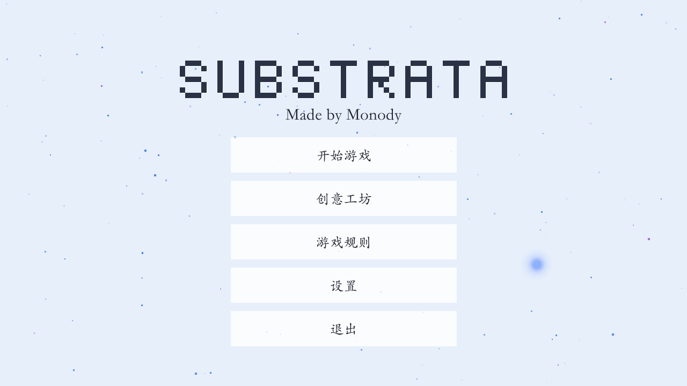

# Substrata

> 分层下落的 3D 方块解谜。场地有深度，方块能绕三个轴翻转；
> 水会流、火会烧、沙会塌，整个场地会一层一层往下收。



**这是「我的世界俄罗斯方块」的去 IP 版。** 玩法、机制、代码全部沿用，
方块贴图、名称、图标、背景音乐、界面文案换成了本项目原创或自由许可的素材，
不再包含任何第三方游戏的美术与音频。带 MC 素材的原版维护在 `main` 分支，两边互不影响。

**怎么玩**

- **Windows**：`BuildSubstrata\Substrata.exe`（不用装 Unity，双击就跑）
- **从源码**：见下面「从源码运行」

## 这是什么

一个把下落式方块玩法搬进**有深度的 3D 场地**的解谜游戏。

和常见下落方块的区别：

- **3D 场地**：x / y / z 三轴可调（默认 10 × 20 × 1），W / S 把方块往深处挪，
  消除可以在层内，也可以整列消
- **三轴翻转**：除了面内旋转，还能俯视转 90°（绕竖直轴）和前后翻 90°（绕水平轴），
  一共 24 种朝向
- **会动的方块**：沙、粉尘、砾石、盐下面是空的就塌落；水、岩浆、酸、燃料按「定体积份数」流动，
  岩浆遇水凝成黑曜石；纸、木、叶挨着火就烧，火会顺着蔓延；炸药被点着后连锁爆炸
- **结构方块**：落定时记住整块场地，被消行或炸掉时先把场上的方块从下往上一格格收掉，
  再按记忆掉回来重建
- **自定义模具（创意工坊）**：在 5×5×5 的建造盒里像搭积木一样拼自己的方块，
  最多 8 格、必须六连通；搭好的模具与七种默认方块一起参与随机，也能绕三个轴翻转
- **层次俯视图**：场地深于两层时，可以在右侧拖滑条逐层俯视，标注每层还差几格

## 当前状态

去 IP 改造进行中。**方块贴图、图标、音效、名称、界面文案已经全部换成原创**；
只剩界面字体还是华文楷体（商用需授权），换掉就能出可分发版本。

已完成：

- 58 种方块 × 顶 / 侧 / 底三面贴图，全部由 `tools/build_substrata_atlas.py` 程序化绘制
  （固定随机种子，可复现），不含任何第三方贴图
- 方块表、机制标签、音效组、透明标记由同一份脚本导出到 `BlockCatalogData.cs`，
  图集编号和代码永远不会错位
- 机制改为按标签挂载（`gravity` / `flammable` / `liquid` / `explosive` / `fuse`），
  以后加方块只改数据，不动代码
- 图鉴、规则页、教程文案重写为 Substrata 的一套说法
- 主菜单 logo 换成自绘的 SUBSTRATA 像素字
- 音效全部改为程序合成：9 组材质放置音（各 4 个变体）+ 17 个界面音，
  固定种子可复现，音效目录从 298 个文件缩到 53 个
- 存档格式加版本号，旧存档自动作废（方块 id 全变了，救不回来）
- 应用图标重做：草 / 土 / 石三层地层 + 上方落下的方块
- 逻辑自检 381 项全部通过

还欠着：

- 界面字体从华文楷体换成思源黑体（OFL，可商用）
- 四端产物重打（Windows / APK / WebGL / 安装包）

## 操作（PC）

| 按键 | 作用 |
|---|---|
| A / D 或 ← / → | 左右移动 |
| W / S 或 ↑ / ↓ | 前后移动（z 轴，场地有深度时才用得上） |
| 空格 | 硬降 |
| Shift | 软降 |
| Q / E | 面内旋转（逆 / 顺时针，绕屏幕法线） |
| Z / C | 俯视旋转（逆 / 顺时针，绕竖直轴） |
| V / R | 前后翻（往正面 / 往背面，绕水平轴） |
| 鼠标拖拽 / 滚轮 | 转视角 / 缩放 |
| Esc | 暂停 |

键位都能在设置里改，改完立即生效。

## 操作（手机）

竖屏游玩。屏幕分三段：上面一条分数横条、中间场地、下面一条操作区。

| 操作 | 作用 |
|---|---|
| 左下拖动区左右划 | 左右移动（划多远走几格） |
| 左下拖动区上下划 | 前后移动（场地有深度时才用得上） |
| 右侧按键 | 面内旋转 / 俯视旋转 / 前后翻 |
| 软降（按住） | 连续下落，按住就一直降 |
| 硬降 | 直接落到底 |
| 单指拖画面 / 双指捏合 | 转视角 / 缩放 |
| 右上角「暂停」 | 暂停（切后台也会自动暂停并存档） |

场地只有一层（z = 1）时，右侧只留四个键：面内左 / 右、软降、硬降。

## 从源码运行

需要 Unity **2022.3.62f3c1**（内置渲染管线）。

1. Unity Hub 里「Add project from disk」，选本目录
2. 打开 `Assets/Scenes/Game.unity`；如果场景丢了或报错，用菜单 `MinecraftTetris → 生成游戏场景` 重新生成
3. 点 Play

跑逻辑自检（不进 Play 模式，直接批处理，381 项）：

```bash
"C:/Program Files/Unity/Hub/Editor/2022.3.62f3c1/Editor/Unity.exe" -batchmode -quit \
  -projectPath . -executeMethod MinecraftTetris.EditorTools.SelfTest.Run -logFile -
```

构建 Windows 版：菜单 `MinecraftTetris → 构建 Windows 版`，产物在 `BuildSubstrata/`
（这个分支的输出目录与 `main` 的 `Build/` 分开，两个游戏不会互相覆盖）。

重新生成方块贴图与方块表：

```bash
python tools/build_substrata_atlas.py     # 出图集 + blocks.json + BlockCatalogData.cs
python tools/audit_tiles.py               # 体检：扫图集里有没有跨色系的杂点
```

## 目录

- `Assets/`
  - `Art/AtlasSubstrata/`：方块图集与 `blocks.json`（方块表）
  - `Resources/Music/`：背景音乐
  - `Resources/Fonts/`：界面字体
  - `Scripts/`：`Core`（纯逻辑，不依赖 MonoBehaviour）/ `Input` / `Camera` / `UI`
  - `Editor/`：自动建场景、构建、材质、逻辑自检
- `docs/`：改造计划、素材画法、设计规格、技术方案
- `tools/`：图集生成、像素质检、图标生成、音乐下载、发布打包
- `Logs/`：调试日志与截图（不进仓库）

## 架构一句话

逻辑层是纯 C#（`GameLoop` / `Grid` / `Fluids` / `PieceRotation`），不继承 MonoBehaviour，
所以能在批处理里跑自检；视图层 `GridView` 只负责把网格状态画成方块；
`Bootstrap` 负责把两边接起来。

## 素材与版权

| 内容 | 来源 | 许可 |
|---|---|---|
| 全部源代码 | 本项目 | MIT（见 [LICENSE](LICENSE)） |
| 方块贴图、图标、主菜单 logo | `tools/` 下的脚本程序化生成 | 本项目原创 |
| 背景音乐 | OpenGameArt 上的 CC0 曲目 | 公有领域 |
| 放置音效、界面音 | `tools/build_sfx.py` 程序合成 | 本项目原创 |
| 界面字体 | 正在替换为思源黑体 | 待定 |

贴图和图标没有引用任何第三方图片，生成参数与随机种子都在脚本里，
可以用 `python tools/build_substrata_atlas.py` 逐像素复现。
